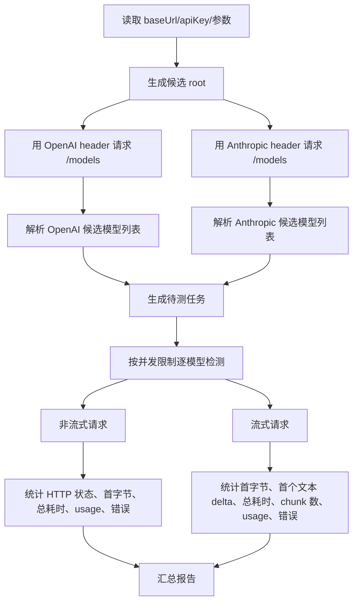

# 大模型接入配置检测工具技术方案

作者：long  
时间：2026-07-01 10:48:00

## 1. 背景与目标

用户提供 `baseUrl` 和 `apiKey` 后，工具需要自动判断该地址暴露的是哪一种大模型接口兼容协议，并对模型列表中的每个模型执行对话探测，给出模型是否可用、非流式耗时、流式首字延迟和总耗时等结果。

这里的“提供商”不按域名判断。最终服务可能不是 OpenAI 官方或 Anthropic 官方，而是任意中转、聚合、私有网关或兼容实现。工具只按协议行为识别：

- OpenAI Chat Completions 兼容协议
- OpenAI Responses 兼容协议
- Anthropic Messages 兼容协议

## 2. 范围

本工具只覆盖两类能力：

1. 模型列表接口
2. 对话接口，包括非流式和流式

第一版不做：

- 价格、额度、余额检测
- embeddings、rerank、images、audio、tools、function calling 等能力检测
- OpenAI Assistants、Batches、Files 等接口检测
- Anthropic Batches、Files、Admin API 等接口检测
- 按模型名称推断真实厂商

## 3. 官方接口依据

已核实的最小接口形态如下。

| 协议类型 | 模型列表 | 非流式对话 | 流式对话 | 鉴权 |
| --- | --- | --- | --- | --- |
| `openai-chat` | `GET /models` | `POST /chat/completions` | 同接口，body 中 `stream: true` | `Authorization: Bearer <apiKey>` |
| `openai-responses` | `GET /models` | `POST /responses` | 同接口，body 中 `stream: true` | `Authorization: Bearer <apiKey>` |
| `anthropic-messages` | `GET /models` | `POST /messages` | 同接口，body 中 `stream: true` | `x-api-key: <apiKey>` 和 `anthropic-version: 2023-06-01` |

参考来源：

- OpenAI API OpenAPI 定义：`https://platform.openai.com/docs/static/api-definition.yaml`
- Anthropic Models API：`https://docs.anthropic.com/en/api/models-list.md`
- Anthropic Messages API：`https://docs.anthropic.com/en/api/messages.md`
- Anthropic Version header：`https://docs.anthropic.com/en/api/versioning.md`

## 4. 输入与命令设计

建议第一版做成 Go CLI，原因是单文件二进制易分发，`net/http`、SSE 解析、并发控制和耗时统计都能用标准库实现，避免用户安装 Node/Python 运行时。

命令示例：

```bash
apicheck \
  --base-url "https://example.com/v1" \
  --api-key "sk-xxx" \
  --protocol auto \
  --mode both \
  --concurrency 2 \
  --timeout 60s \
  --format table
```

核心参数：

| 参数 | 默认值 | 说明 |
| --- | --- | --- |
| `--base-url` | 必填 | 用户提供的 API 根地址 |
| `--api-key` | 必填，也支持环境变量 | 用户提供的 key，输出中永不明文展示 |
| `--protocol` | `auto` | `auto/openai-chat/openai-responses/anthropic-messages/openai/all` |
| `--mode` | `both` | `nonstream/stream/both` |
| `--concurrency` | `2` | 模型探测并发数，默认保守避免触发限流 |
| `--timeout` | `60s` | 单次请求总超时 |
| `--connect-timeout` | `10s` | TCP/TLS 建连超时 |
| `--filter` | 空 | 只检测匹配模型 ID 的模型 |
| `--max-models` | `0` | 0 表示不限制；调试时可限制数量 |
| `--format` | `table` | `table/json/markdown` |
| `--output` | 空 | 输出结果文件路径 |
| `--insecure-skip-verify` | `false` | 仅用于用户明确需要测试自签名网关时 |

## 5. baseUrl 规范化

兼容用户可能输入以下形式：

- `https://host`
- `https://host/v1`
- `https://host/api/v1`
- `https://host/v1/models`
- `https://host/v1/chat/completions`
- `https://host/v1/messages`

规范化步骤：

1. 去掉末尾 `/`。
2. 如果 URL path 以已知端点结尾，则回退到 root：
   - `/models`
   - `/chat/completions`
   - `/responses`
   - `/messages`
3. 生成候选 root：
   - 原始 root
   - 如果 path 不以 `/v1` 结尾，则追加 `/v1`
4. 去重，保持顺序。

示例：

| 用户输入 | 候选 root |
| --- | --- |
| `https://api.example.com` | `https://api.example.com`, `https://api.example.com/v1` |
| `https://api.example.com/v1` | `https://api.example.com/v1` |
| `https://api.example.com/proxy/v1` | `https://api.example.com/proxy/v1` |
| `https://api.example.com/v1/chat/completions` | `https://api.example.com/v1` |

## 6. 协议识别策略

不能用域名判断，也不能用模型名判断。识别分两层：

1. 鉴权 + 模型列表是否可用
2. 对话端点是否可用

### 6.1 模型列表探测

对每个候选 root 发起两种模型列表请求。

OpenAI-compatible：

```http
GET {root}/models
Authorization: Bearer <apiKey>
Accept: application/json
```

Anthropic-compatible：

```http
GET {root}/models
x-api-key: <apiKey>
anthropic-version: 2023-06-01
Accept: application/json
```

响应解析规则：

| 类型 | 主要特征 |
| --- | --- |
| OpenAI 模型列表 | 通常有 `data[]`，模型 ID 在 `data[].id`；常见字段有 `object`, `owned_by` |
| Anthropic 模型列表 | `data[]`，模型 ID 在 `data[].id`；常见字段有 `display_name`, `created_at`, `capabilities`, `max_tokens`, `type: "model"` |

注意：

- 只要 `data[].id` 可解析，就允许进入后续端点探测。
- 结构特征只用于置信度，不作为唯一依据。
- 有些中转会复用 OpenAI 的 `/models` 返回 Claude 模型名，仍然应按端点行为判断协议。
- 有些服务可能同时支持 OpenAI 和 Anthropic header，工具应保留多协议候选。

### 6.2 对话端点探测

模型列表成功后，不能直接认定协议。需要对候选协议端点做请求级探测：

| 候选协议 | 探测端点 |
| --- | --- |
| `openai-chat` | `POST {root}/chat/completions` |
| `openai-responses` | `POST {root}/responses` |
| `anthropic-messages` | `POST {root}/messages` |

第一版不单独做“端点预探测”，而是在逐模型检测时直接记录每个模型、每个协议端点的结果。这样可以避免某些服务出现“端点存在，但部分模型不支持该接口”的误判。

## 7. 模型检测流程

整体流程：



任务维度：

```text
root + protocol + model + mode
```

例如同一个模型可能得到：

```text
claude-sonnet-4-5
  openai-chat:        nonstream ok, stream ok
  openai-responses:   endpoint_not_found
  anthropic-messages: not_tested
```

## 8. 请求体设计

检测 prompt 要尽量短，减少费用和延迟，同时不依赖具体知识。

统一 prompt：

```text
Reply with exactly: pong
```

### 8.1 OpenAI Chat Completions

默认请求体尽量保持最小，避免第三方兼容服务因为不支持额外参数而误报不可用：

```json
{
  "model": "MODEL_ID",
  "messages": [
    {
      "role": "user",
      "content": "Reply with exactly: pong"
    }
  ],
  "stream": false
}
```

流式：

```json
{
  "model": "MODEL_ID",
  "messages": [
    {
      "role": "user",
      "content": "Reply with exactly: pong"
    }
  ],
  "stream": true
}
```

说明：

- 默认不加 `temperature`，避免某些模型拒绝该参数。
- 默认不加 `max_tokens` 或 `max_completion_tokens`，避免不同兼容实现对 token 参数差异导致误判。
- 后续可加 `--token-limit-mode`，让用户选择 `none/max_tokens/max_completion_tokens`。

### 8.2 OpenAI Responses

非流式：

```json
{
  "model": "MODEL_ID",
  "input": "Reply with exactly: pong",
  "max_output_tokens": 8,
  "stream": false
}
```

流式：

```json
{
  "model": "MODEL_ID",
  "input": "Reply with exactly: pong",
  "max_output_tokens": 8,
  "stream": true
}
```

说明：

- Responses 官方最小核心是 `model + input`。
- `max_output_tokens` 用于控制探测成本；如果兼容服务不支持该字段，可在 retry 策略中降级为不带该字段重试一次。

### 8.3 Anthropic Messages

非流式：

```json
{
  "model": "MODEL_ID",
  "max_tokens": 8,
  "messages": [
    {
      "role": "user",
      "content": "Reply with exactly: pong"
    }
  ],
  "stream": false
}
```

流式：

```json
{
  "model": "MODEL_ID",
  "max_tokens": 8,
  "messages": [
    {
      "role": "user",
      "content": "Reply with exactly: pong"
    }
  ],
  "stream": true
}
```

说明：

- Anthropic Messages API 要求 `max_tokens`，所以这里必须带。
- Anthropic 没有 message 级 `system` role，检测请求不使用 system。

## 9. 流式解析与首字统计

### 9.1 统一计时点

每个请求记录：

| 字段 | 含义 |
| --- | --- |
| `startAt` | 发起请求前 |
| `firstByteMs` | 收到响应头或第一批 body 字节的时间 |
| `firstEventMs` | 流式时解析到第一个 SSE event 的时间 |
| `firstTextMs` | 流式时解析到第一个非空文本 delta 的时间 |
| `totalMs` | 请求完整结束或失败的时间 |

非流式也记录 `firstByteMs` 和 `totalMs`。非流式没有 `firstTextMs`，因为整个 JSON 一次返回。

### 9.2 OpenAI Chat Completions 流式

SSE 数据示例特征：

```text
data: {"choices":[{"delta":{"content":"pong"}}]}
data: [DONE]
```

首字文本提取：

```text
choices[].delta.content
```

完成判断：

- 收到 `data: [DONE]`
- 或 HTTP body EOF
- 或解析到 `choices[].finish_reason != null`

### 9.3 OpenAI Responses 流式

SSE 事件示例特征：

```text
event: response.output_text.delta
data: {"type":"response.output_text.delta","delta":"pong"}
```

首字文本提取：

```text
type == "response.output_text.delta" 时读取 delta
```

完成判断：

- `response.completed`
- `response.failed`
- `response.incomplete`
- HTTP body EOF

### 9.4 Anthropic Messages 流式

SSE 事件示例特征：

```text
event: content_block_delta
data: {"type":"content_block_delta","delta":{"type":"text_delta","text":"pong"}}
```

首字文本提取：

```text
type == "content_block_delta" 且 delta.type == "text_delta" 时读取 delta.text
```

完成判断：

- `message_stop`
- `error`
- HTTP body EOF

## 10. 可用性判定

每个模型、每个协议、每种模式都会独立给结果。

判定等级：

| 状态 | 含义 |
| --- | --- |
| `ok` | HTTP 成功，响应结构可解析，并产生有效对话结果或有效完成事件 |
| `auth_failed` | 401/403，key 无效或 header 协议不匹配 |
| `endpoint_not_found` | 404，端点不存在或 root 错误 |
| `model_not_found` | 错误信息明确表示模型不存在 |
| `unsupported_model` | 端点存在，但模型不支持该协议 |
| `rate_limited` | 429 或等价错误 |
| `quota_exceeded` | 额度不足、余额不足、billing hard limit |
| `invalid_request` | 400 且无法归类为模型/参数不支持 |
| `timeout` | 请求超过配置超时 |
| `network_error` | DNS、TCP、TLS、连接重置等 |
| `parse_error` | JSON/SSE 解析失败 |
| `protocol_mismatch` | 返回内容明显不是当前协议格式 |

模型总状态：

```text
available = 任意协议的任意模式 ok
fully_available = 该协议下非流式和流式都 ok
```

## 11. 重试与降级

默认不对所有错误盲目重试，只对可能瞬时失败的场景重试：

- `429`
- `5xx`
- 网络连接重置
- 读超时

默认重试：

```text
maxAttempts = 2
backoff = 500ms, 1500ms
```

参数兼容降级：

1. `openai-responses` 如果带 `max_output_tokens` 返回明确“不支持参数”，去掉该字段重试一次。
2. `openai-chat` 默认不带 token 限制，避免第一版因 `max_tokens` 和 `max_completion_tokens` 差异误判。
3. `anthropic-messages` 不去掉 `max_tokens`，因为这是必需字段。

## 12. 并发与限流

默认并发为 2。原因：

- 用户可能测试聚合站，限流策略不透明。
- 每个模型要做非流式和流式，任务数可能很大。
- 默认保守可以降低误判率。

调度策略：

```text
按模型维度入队
每个模型内部按协议顺序执行
协议内部按 mode 执行
全局 worker pool 控制并发
```

后续可增加：

- `--concurrency-per-protocol`
- `--delay-between-requests`
- `--stop-on-auth-error`
- `--skip-stream-on-nonstream-fail`

第一版建议默认：

- 如果某协议所有模型连续 3 次都是 `endpoint_not_found`，停止该协议后续任务。
- 如果某 root 某 header 模型列表是 `auth_failed`，不生成该 header 对应协议任务。

## 13. 输出设计

### 13.1 table 输出

```text
Root: https://example.com/v1
Models: 12

MODEL                  PROTOCOL             NONSTREAM   STREAM     FIRST_TEXT   TOTAL     ERROR
gpt-4o-mini            openai-chat          ok 820ms    ok 430ms   410ms        980ms     -
gpt-4o-mini            openai-responses     ok 900ms    ok 460ms   440ms        1020ms    -
claude-sonnet-4-5      anthropic-messages   ok 1100ms   ok 620ms   590ms        1300ms    -
claude-sonnet-4-5      openai-chat          failed      failed     -            -         unsupported_model
```

### 13.2 JSON 输出

```json
{
  "baseUrl": "https://example.com/v1",
  "checkedAt": "2026-07-01T10:48:00+08:00",
  "roots": [
    {
      "url": "https://example.com/v1",
      "modelList": [
        {
          "protocolFamily": "openai",
          "status": "ok",
          "latencyMs": 320,
          "modelCount": 2
        }
      ]
    }
  ],
  "models": [
    {
      "id": "gpt-4o-mini",
      "results": [
        {
          "protocol": "openai-chat",
          "nonstream": {
            "status": "ok",
            "httpStatus": 200,
            "firstByteMs": 410,
            "totalMs": 820,
            "outputPreview": "pong",
            "usage": {
              "inputTokens": 12,
              "outputTokens": 2,
              "totalTokens": 14
            }
          },
          "stream": {
            "status": "ok",
            "httpStatus": 200,
            "firstByteMs": 390,
            "firstEventMs": 400,
            "firstTextMs": 430,
            "totalMs": 980,
            "chunkCount": 5,
            "outputPreview": "pong"
          }
        }
      ]
    }
  ],
  "summary": {
    "totalModels": 2,
    "availableModels": 2,
    "protocolsDetected": ["openai-chat", "openai-responses"],
    "errors": {
      "rate_limited": 0,
      "endpoint_not_found": 1
    }
  }
}
```

## 14. 代码结构

建议 Go 项目结构：

```text
.
├── cmd/
│   └── apicheck/
│       └── main.go
├── internal/
│   ├── config/
│   │   └── config.go
│   ├── detect/
│   │   ├── normalize.go
│   │   └── models.go
│   ├── protocol/
│   │   ├── types.go
│   │   ├── openai_chat.go
│   │   ├── openai_responses.go
│   │   └── anthropic_messages.go
│   ├── runner/
│   │   ├── scheduler.go
│   │   └── metrics.go
│   ├── sse/
│   │   └── parser.go
│   ├── report/
│   │   ├── table.go
│   │   ├── json.go
│   │   └── markdown.go
│   └── redact/
│       └── redact.go
├── docs/
│   └── api-checker-technical-design.md
├── go.mod
└── README.md
```

核心接口：

```go
type Protocol interface {
    Name() ProtocolName
    ListModels(ctx context.Context, root RootCandidate, key APIKey) ModelListResult
    CheckNonStream(ctx context.Context, root RootCandidate, key APIKey, model Model) CheckResult
    CheckStream(ctx context.Context, root RootCandidate, key APIKey, model Model) CheckResult
}
```

各协议实现只负责：

- 生成请求
- 解析响应
- 提取文本
- 提取 usage
- 归类协议内错误

调度器负责：

- 并发控制
- 超时
- 重试
- 任务取消
- 汇总报告

## 15. 测试方案

### 15.1 单元测试

| 模块 | 测试点 |
| --- | --- |
| URL 规范化 | root 生成、端点回退、去重、不重复追加 `/v1` |
| SSE 解析 | 多行 `data:`、空行分隔、`event:`、`[DONE]`、异常 JSON |
| OpenAI Chat 解析 | 非流式 choices、流式 delta、finish_reason、usage |
| OpenAI Responses 解析 | output text、`response.output_text.delta`、`response.completed`、usage |
| Anthropic Messages 解析 | content text、`content_block_delta`、`message_stop`、usage |
| 错误分类 | 401/403/404/429/5xx/timeout/parse error |
| 脱敏 | API key、Authorization header、x-api-key 不泄漏 |

### 15.2 集成测试

用 `httptest.Server` 构造假服务：

1. 只支持 OpenAI Chat
2. 只支持 OpenAI Responses
3. 同时支持 OpenAI Chat 和 Responses
4. 只支持 Anthropic Messages
5. `/models` 成功但对话端点 404
6. `/models` 成功但部分模型 400 unsupported
7. 流式首个 chunk 没有文本，第二个 chunk 才有文本
8. 流式中途断开
9. 429 后重试成功
10. key 错误导致 401

### 15.3 真实服务冒烟

真实服务测试只在用户提供 key 时手动执行：

```bash
apicheck --base-url "$BASE_URL" --api-key "$API_KEY" --max-models 1 --format json
```

冒烟通过标准：

- 模型列表能返回
- 至少一个模型非流式成功
- 如果服务声明支持流式，则至少一个模型流式成功并记录 `firstTextMs`

## 16. 安全与隐私

工具必须遵守：

- 不在日志、错误、JSON 输出中打印完整 key。
- HTTP debug 输出默认关闭。
- 错误中如果包含 key，必须脱敏后再展示。
- 不自动把结果上传到远端。
- 不把用户输入的 key 写入配置文件，除非用户显式使用 `--save-profile` 之类功能；第一版不做保存。

脱敏规则：

```text
sk-abcdef1234567890 -> sk-a***********7890
```

## 17. 风险与处理

| 风险 | 处理 |
| --- | --- |
| 聚合服务模型很多，检测成本高 | 默认并发低，支持 `--max-models` 和 `--filter` |
| 第三方 OpenAI Chat 对 token 参数兼容差 | 默认请求体最小化，不带 `max_tokens` |
| Responses 兼容实现不完整 | `openai-responses` 独立记录，不影响 `openai-chat` |
| 同一模型只支持部分协议 | 结果按 `model + protocol + mode` 展示 |
| 流式响应不是标准 SSE | 标记 `stream_protocol_error`，保留非流式结果 |
| 网关返回 HTML 错误页 | 标记 `parse_error` 并展示 HTTP 状态和 Content-Type |
| 429/额度不足误判为模型不可用 | 单独归类 `rate_limited`、`quota_exceeded` |

## 18. 第一阶段交付计划

### 阶段 1：CLI 骨架与协议核心

- 初始化 Go 项目
- 实现参数解析、URL 规范化、HTTP client、脱敏
- 实现 OpenAI `/models`
- 实现 Anthropic `/models`

### 阶段 2：对话检测

- 实现 `openai-chat` 非流式和流式
- 实现 `openai-responses` 非流式和流式
- 实现 `anthropic-messages` 非流式和流式
- 实现 SSE parser 和首字统计

### 阶段 3：报告与测试

- 实现 table/json 输出
- 补齐 `httptest` 集成测试
- 写 README 使用示例
- 用用户提供的真实 `baseUrl + apiKey` 做冒烟验证

## 19. 默认行为总结

第一版默认行为可以概括为：

```text
不猜厂商，不猜模型。
先通过 /models 验证 key 和 root。
再用每个协议的真实对话端点逐模型测试。
流式按第一个非空文本 delta 统计首字。
结果按 model + protocol + nonstream/stream 独立呈现。
```


---

## 20. GUI 方案：Go + Wails

### 20.1 选型理由

| 方案 | 优点 | 缺点 |
| --- | --- | --- |
| **Go + Wails** | 与核心检测代码语言统一，HTTP/SSE/并发全部标准库可覆盖，macOS 原生 `.app`，开发调试最快 | Wails 生态小于 Tauri，但对本工具无实质影响 |
| Tauri 2 + React | 产物体积更小，Rust 性能上限高 | Rust 学习曲线更重，HTTP/SSE/并发实现复杂度更高 |
| Electron | 成熟 | 体积大，内存占用高 |
| SwiftUI 原生 | 最原生 | 前端表格/进度展示能力弱 |

### 20.2 技术栈

```text
Frontend:  React 18 + TypeScript + Tailwind CSS
Backend:   Go (Wails 2)
HTTP:      net/http
SSE:       bufio.Scanner + SSE 行级解析
UI 组件:   自建表格组件 + Lucide 图标
```

### 20.3 项目结构

```text
.
├── cmd/
│   └── apicheck/
│       └── main.go
├── frontend/
│   ├── src/
│   │   ├── App.tsx
│   │   ├── components/
│   │   │   ├── ConfigPanel.tsx
│   │   │   ├── ModelTable.tsx
│   │   │   ├── ProgressPanel.tsx
│   │   │   ├── ProtocolBadge.tsx
│   │   │   └── ErrorDetail.tsx
│   │   ├── hooks/
│   │   │   └── useChecker.ts
│   │   ├── types/
│   │   │   └── index.ts
│   │   └── main.tsx
│   └── package.json
├── internal/
│   ├── app/
│   │   └── app.go             # Wails 绑定入口
│   ├── config/
│   │   └── config.go
│   ├── detect/
│   │   ├── normalize.go
│   │   └── models.go
│   ├── protocol/
│   │   ├── types.go
│   │   ├── openai_chat.go
│   │   ├── openai_responses.go
│   │   └── anthropic_messages.go
│   ├── runner/
│   │   ├── scheduler.go
│   │   └── metrics.go
│   ├── sse/
│   │   └── parser.go
│   ├── report/
│   │   ├── table.go
│   │   ├── json.go
│   │   └── markdown.go
│   └── redact/
│       └── redact.go
├── docs/
│   └── api-checker-technical-design.md
├── go.mod
└── README.md
```

### 20.4 Wails 暴露给前端的接口

```go
type ProgressEvent struct {
    TotalModels   int    `json:"totalModels"`
    DoneModels    int    `json:"doneModels"`
    CurrentModel  string `json:"currentModel"`
    ElapsedMs     int64  `json:"elapsedMs"`
    RemainingHint string `json:"remainingHint"`
}

type ModelCheckResult struct {
    ModelID    string                   `json:"modelId"`
    Protocol   string                   `json:"protocol"`
    NonStream  *CheckResult             `json:"nonStream"`
    Stream     *CheckResult             `json:"stream"`
}

type App struct {
    ctx context.Context
}

func (a *App) ListModels(baseURL, apiKey, protocol string, timeoutSecs int) ([]ModelInfo, error)
func (a *App) CheckAll(baseURL, apiKey, protocol, mode string, concurrency, timeoutSecs int, filter string, maxModels int, onProgress func(ProgressEvent)) (CheckSummary, error)
```

前端调用方式：

```typescript
import { ListModels, CheckAll } from '../wailsjs/go/main/App';
import { EventsOn } from '../wailsjs/runtime/runtime';

EventsOn('check-progress', (e: ProgressEvent) => {
  // 更新进度条与模型表格状态
});
```

### 20.5 GUI 界面设计

#### 主界面布局

```text
┌──────────────────────────────────────────────────────────────┐
│  API Checker                                    [最小化][关闭] │
├──────────────────────────────────────────────────────────────┤
│  Base URL   [____________________________________]          │
│  API Key    [____________________________________]  [👁]    │
│  协议       [自动检测 ▼]  模式 [两者 ▼]  并发 [2 ▼]         │
│                                                              │
│  [开始检测]                                    [导出 JSON]   │
├──────────────────────────────────────────────────────────────┤
│  进度  ████████████░░░░░░░░  3/12 模型完成  预计剩余 45s    │
├──────────────────────────────────────────────────────────────┤
│  模型 ID              │ 协议            │ 非流式   │ 流式    │
│  ─────────────────────┼─────────────────┼─────────┼─────────│
│  gpt-4o-mini          │ openai-chat     │ ✅ 820ms│ ✅ 980ms│
│  gpt-4o-mini          │ openai-responses│ ✅ 900ms│ ✅1020ms│
│  claude-sonnet-4-5    │ anthropic-msg   │ ✅1100ms│ ✅1300ms│
│  claude-sonnet-4-5    │ openai-chat     │ ❌      │ ❌      │
│  embedding-ada-002    │ openai-chat     │ ⚠️ 400  │ ⚠️ 400  │
├──────────────────────────────────────────────────────────────┤
│  状态栏: 检测完成 | 12 模型 | 8 可用 | 2 不支持 | 2 超时   │
└──────────────────────────────────────────────────────────────┘
```

#### 交互细节

1. 输入区包含 Base URL、API Key（支持明密文切换）和协议/模式/并发配置。
2. 点击“开始检测”后锁定输入区，按钮切换为“停止检测”。
3. 模型表格实时更新，检测完成后支持导出 JSON。
4. 底部状态栏显示汇总统计。

### 20.6 Go 后端核心实现

```go
func (a *App) checkStream(client *http.Client, root, apiKey, modelID string, timeout time.Duration) (TimingMetrics, *StreamCheckResult, error) {
    url := root + "/chat/completions"
    body := map[string]any{
        "model":    modelID,
        "messages": []map[string]string{{"role": "user", "content": "Reply with exactly: pong"}},
        "stream":   true,
    }
    reqBytes, _ := json.Marshal(body)

    req, _ := http.NewRequestWithContext(context.Background(), http.MethodPost, url, bytes.NewReader(reqBytes))
    req.Header.Set("Content-Type", "application/json")
    req.Header.Set("Authorization", "Bearer "+apiKey)

    start := time.Now()
    resp, err := client.Do(req)
    // SSE 流式解析：
    // data: {"choices":[{"delta":{"content":"pong"}}]}
    // data: [DONE]
    // 首字文本提取：choices[].delta.content
}
```

### 20.7 macOS 打包

```bash
# 开发模式
wails dev

# 打包为 .app
wails build -platform darwin/universal

# 最终产物
build/bin/apicheck.app
```

### 20.8 依赖清单

```go
// go 核心依赖示例
require (
    github.com/wailsapp/wails/v2 v2.9.1
)
```

前端依赖不变：

```json
{
  "dependencies": {
    "react": "^18",
    "react-dom": "^18",
    "lucide-react": "^0.400"
  },
  "devDependencies": {
    "typescript": "^5",
    "vite": "^6",
    "@vitejs/plugin-react": "^4",
    "tailwindcss": "^4"
  }
}
